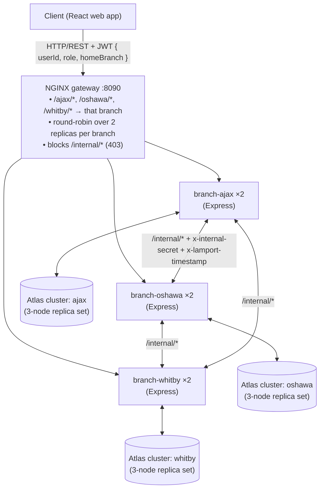

# Distributed Public Library Management System

**Course:** SOFE 4790U — Distributed Systems (Ontario Tech University)

---

## 1. Overview

A distributed, multi-branch public library system for a regional network spanning **Ajax**, **Oshawa** and **Whitby**. There is no central database: each branch is an autonomous node backed by its own isolated MongoDB Atlas cluster.

Patrons reach every branch through one API gateway. When a book isn't at their branch, the branch asks its peers in parallel, still answers if a peer is offline, and can move the copy over with a fault-tolerant **inter-library transfer saga**.

---

## 2. System Architecture



### Core principles

* **One codebase, identity from the environment:** all branches run the same `server/` code, configured by `BRANCH_ID`, `MONGO_URI`, `PEER_URLS` and `PORT`. A misconfigured branch refuses to boot (`src/config/env.js`).
* **Strict database isolation:** a branch only ever talks to its own cluster. Everything cross-branch goes over HTTP `/internal/*`, authenticated with a shared `INTERNAL_API_SECRET`.
* **Stateless app tier:** auth is a JWT (`{ userId, role, homeBranch }`) that any replica of any branch can verify, so replicas scale horizontally behind NGINX.

---

## 3. Distributed Systems Features

| Concept | Implementation |
| :--- | :--- |
| **Federated search** (`services/catalogSearch.js`) | Local first. On a miss, the branch sends `GET /internal/books/:isbn10` to every healthy peer in parallel (`Promise.allSettled`, `PEER_TIMEOUT_MS` = 3 s). The response lists `foundAt` (which branches have it) and `offline`. |
| **Failover** | `discoveryService` heartbeats every peer (`DISCOVERY_INTERVAL_MS` = 5 s) and marks a peer unhealthy after 3 failed probes. Search then skips it instead of waiting out the timeout, and adds a `warning` naming unreachable branches. One healthy probe brings it back. |
| **Inter-library transfer saga** (`services/transferSaga.js`) | 1) lock the copy locally (`status: IN_TRANSIT`, `activeTransferId`), 2) `POST /internal/transfers/receive` to the target, 3) delete locally and log `COMMITTED`. If step 2 fails or times out, a compensating step unlocks the copy (`ROLLED_BACK`). The receiver is idempotent by `sagaId`, so retries never duplicate a book. |
| **Concurrency control** | Every copy is one `Library` document. Checkout and the transfer lock are single atomic `findOneAndUpdate`s that only match `status: AVAILABLE, activeTransferId: null`, so of N simultaneous requests exactly one wins and the rest get `409`. |
| **Lamport logical clocks** (`utils/lamportClock.js`) | Branches may have skewed wall clocks (different timezones), so cross-branch ordering uses Lamport time only. Every peer request and response carries `x-lamport-timestamp`, and the receiver applies $C = \max(C_{\text{local}}, C_{\text{incoming}}) + 1$. |
| **Replication & high availability** | Each Atlas cluster is a 3-node replica set. The driver fails over to a new primary on its own, and `retryWrites=true&w=majority` retries a write once and confirms it on a majority. Each branch also runs 2 app replicas. NGINX skips a replica whose `GET /healthz` is not ready (503) and retries the other. |

### Planned (designed, not built yet)

* `Loan` documents with `custodyHistory`, so returned books route back to their origin branch
* Return / check-in endpoint (today a checked-out copy stays `BORROWED`)
* Physical vs. digital media (digital titles borrowable remotely without a transfer)
* Recommendations service

---

## 4. API

All public routes go through the gateway as `http://localhost:8090/<branch>/...`, e.g. `/oshawa/api/circulation/books/0262033844`.

| Method & path | Auth | Purpose |
| :--- | :--- | :--- |
| `GET /healthz` | – | Readiness: 200 when this replica's DB is connected, else 503 |
| `POST /api/auth/register` | – | `{ email, password, name }` → `{ token, user }`. New users are patrons at the branch that handled the request. |
| `POST /api/auth/login` | – | `{ email, password }` → `{ token, user }` |
| `GET /api/auth/me` | JWT | Current user |
| `GET /api/auth/google` | – | Start Google sign-in, which ends at `CLIENT_URL/auth/callback#token=…` |
| `GET /api/circulation/books/:isbn10` | – | Federated search: 200 with `foundAt`, or 404. Includes `offline` and `warning` when peers are down. |
| `POST /api/circulation/checkout` | JWT | `{ isbn10 }`: borrow a copy held here. 409 `BOOK_UNAVAILABLE`, 404 `BOOK_NOT_FOUND`. |
| `POST /api/circulation/transfers` | – (temporarily) | `{ isbn10, targetBranch }`: run the transfer saga |
| `GET /internal/health`, `GET /internal/books/:isbn10`, `POST /internal/transfers/receive` | `x-internal-secret` | Peer-only; blocked at the gateway |

Errors are JSON: `{ "error": "...", "code": "..." }`.

---

## 5. Repository Structure

```text
Final_Project/
├── .env                       # Your secrets (git-ignored), see "Environment" below
├── .github/workflows/ci.yml   # Tests (with a throwaway mongo:7) + Docker build
├── docker-compose.yml         # NGINX gateway + 3 branches × 2 replicas (DBs are on Atlas)
├── gateway/nginx.conf         # Per-branch routing, load balancing, /internal/* firewall
├── docs/tdd/                  # TDD evidence reports
├── client/                    # React frontend (Vite)
└── server/                    # One Express backend, runs as ajax / oshawa / whitby
    ├── Dockerfile
    ├── src/
    │   ├── config/            # env.js (validated config), checkConnections.js
    │   ├── models/            # User, Library (one doc per copy), TransferLog
    │   ├── controllers/       # auth, circulation, internal (peer) handlers
    │   ├── services/          # catalogSearch, discoveryService, transferSaga
    │   ├── middlewares/       # JWT requireAuth / requireRole
    │   ├── routes/            # /api/auth, /api/circulation, /internal
    │   ├── utils/             # lamportClock, AppError
    │   ├── seeds/             # seedBranch.js (CSV importer)
    │   └── server.js          # Express app, error handler, boot, graceful shutdown
    └── tests/                 # see "Tests" below
```

---

## 6. Getting Started

### Prerequisites

* **Docker & Docker Compose**
* **Node.js 24+ & npm** (for tests and local runs)
* Three **MongoDB Atlas** clusters (one per branch), with your IP on each cluster's **Network Access** list

### Environment

Create `.env` in the repo root (never commit it):

```bash
MONGO_URI_AJAX=mongodb+srv://...
MONGO_URI_OSHAWA=mongodb+srv://...
MONGO_URI_WHITBY=mongodb+srv://...

JWT_SECRET=long-random-string        # required when NODE_ENV=production
JWT_EXPIRES_IN=1h
INTERNAL_API_SECRET=another-random-string
CLIENT_URL=http://localhost:5173

# Optional: Google login returns 501 without these
GOOGLE_CLIENT_ID=xxxx.apps.googleusercontent.com
GOOGLE_CLIENT_SECRET=xxxx
```

Generate a secret with `node -e "console.log(require('crypto').randomBytes(32).toString('hex'))"`.

> Under Docker, `docker-compose.yml` sets `JWT_SECRET` itself, so the `.env` value only applies to local (non-Docker) runs.

For Google login, register one redirect URI per branch in Google Cloud Console:
`http://localhost:8090/{ajax,oshawa,whitby}/api/auth/google/callback`.

### Run the network (Docker)

```bash
docker compose up --build
```

This starts the gateway at **http://localhost:8090** and 2 replicas of each branch, with hot reload on `server/src/`.

```bash
curl http://localhost:8090/oshawa/healthz
```

### Run without Docker (one terminal per branch, PowerShell, from `server/`)

```bash
$env:BRANCH_ID="ajax"; $env:PORT="3001"; npm run dev
```

Repeat with `oshawa` on port 3002 and `whitby` on port 3003. There's no gateway in this mode, so Google login won't work.

### Seed a branch

```bash
$env:BRANCH_ID="ajax"; npm run seed ./path/to/ajax_items.csv
```

### Troubleshooting

* **502 from the gateway / `Could not connect to any servers in your MongoDB Atlas cluster`:** your IP isn't on the cluster's Network Access list, or the cluster is paused. Fix it in Atlas, then run `docker compose restart`. nodemon doesn't retry on its own.
* **Gateway won't start:** something else is using port 8090.

---

## 7. Tests

Run from `server/`:

| Command | What it covers | Needs |
| :--- | :--- | :--- |
| `npm test` | Auth/JWT/OAuth, env validation, federated search, failover (dead or unhealthy peers, warnings, heartbeats) | nothing; DB mocked, peers are local HTTP servers. **Runs in CI.** |
| `npm run test:db` | Concurrency: 10 parallel checkouts of the last copy, checkout vs. transfer race, in-transit/borrowed guards | a real MongoDB (`MONGO_URI`, or `MONGO_URI_OSHAWA` from `.env`); writes and deletes `TEST-CC-*` rows |
| `npm run test:trans` | Transfer saga: commit, rollback on timeout, double-transfer, idempotent receive | Atlas (oshawa); writes and deletes `TEST-*` rows |
| `npm run test:lb` | NGINX load balancing and replica failover | the Docker stack running |

Add `--verbose` (e.g. `npx jest tests/failover.test.js --verbose`) to see each test as it runs.
